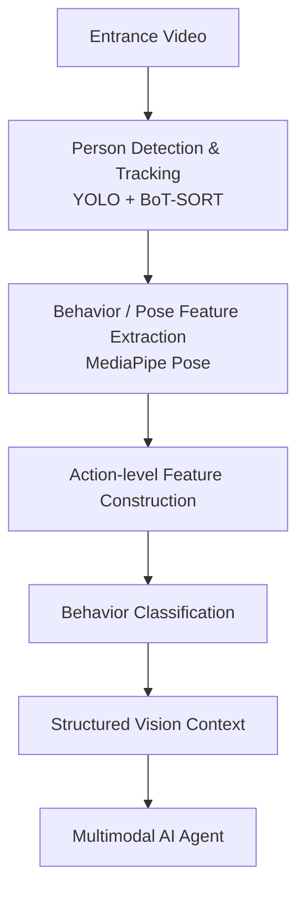
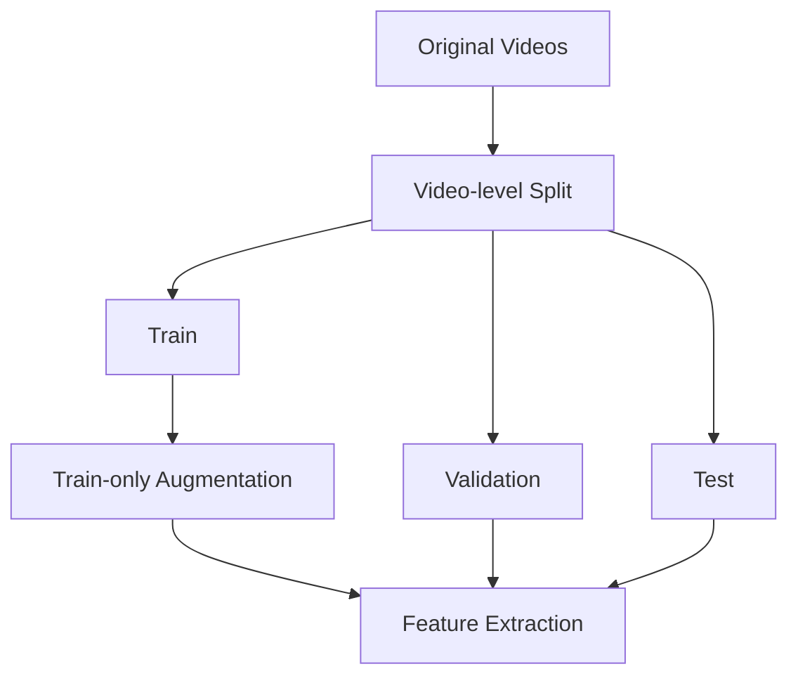

# Vision-based Anomalous Behavior Analysis for Entrance Security

> 2026 Undergraduate Capstone Project

This repository contains the Vision AI pipeline for a multimodal AI agent-based entrance security system.
The project aims to analyze human behavior near an entrance using object tracking and pose information, and to provide structured visual context for downstream multimodal risk reasoning.

## Project Overview

The overall system analyzes video and audio signals from an entrance environment and integrates multimodal information for LLM-based risk assessment.
This repository focuses on the **Vision AI pipeline**:



## Dataset

The project currently uses:
- [AIHub Video data of abnormal behavior in residential and public spaces](https://aihub.or.kr/aihubdata/data/view.do?dataSetSn=515)
- Custom-recorded entrance videos

The custom dataset includes both anomalous and normal entrance scenarios.

### Anomalous Behavior Examples
- Repeatedly pressing the doorbell
- Repeated attempts to open the door
- Kicking the door
- Attempting to look inside
- Prolonged knocking
- Loitering near the entrance

### Normal Behavior Examples
- Normal entrance behavior
- Delivery scenarios
- Waiting after pressing the doorbell
- Passing by the entrance

Additional data collection is currently in progress to reduce class imbalance and improve scenario diversity.

## Feature Extraction
The current baseline evaluates statistical behavior and pose features using:

- Random Forest
- XGBoost

Preliminary experiments showed substantial feature overlap between visually similar anomalous behaviors.
During pipeline review, the initial whole-video aggregation strategy was identified as a limitation because it does not explicitly isolate the annotated action intervals and may lose action-specific and temporal information. The feature extraction pipeline is currently being revised to use action-level annotations.

Future experiments will compare statistical feature-based models with temporal and skeleton-based approaches.
### Behavior Features
Tracking-based behavioral features are extracted from frame-level person trajectories.
The current feature engineering process includes statistical aggregation using:
- Mean
- Minimum
- Maximum
- Standard deviation

To better capture entrance interaction patterns, additional behavioral features are currently being investigated, including:
- Person-to-door distance
- Hand-to-door region distance
- Face-to-door distance
- Body-center-to-door distance
- Entrance dwell time
- Number of entrance approaches
- Hand dwell time near the door
- Ratio of frames with hands inside the door interaction region

### Pose Features
MediaPipe Pose is used to extract human skeletal landmarks.
The initial baseline aggregated pose information into statistical features. Since this representation does not explicitly preserve temporal dynamics, sequence-based and graph-based representations are being investigated.

### Action-level Feature Extraction

The initial pipeline extracted statistical features over entire video sequences. However, the AIHub dataset provides action-level annotations with start and end frames for target behaviors.
The feature extraction pipeline is currently being revised to use these annotated action intervals, allowing behavior and pose features to be constructed from the relevant action frames.

## Data Split and Augmentation

The revised pipeline is designed to manage train, validation, and test sets independently to prevent data leakage.
Data augmentation will be applied only to training videos, with augmented samples inheriting the split of their original source videos.



Feature CSV files are separately generated for each split.


## Future Work

- Expand normal and anomalous entrance behavior datasets
- Improve tracking-based behavioral feature engineering
- Evaluate action-level feature extraction
- Compare statistical and temporal behavior representations
- Investigate skeleton-based spatiotemporal modeling
- Convert Vision AI outputs into structured context for multimodal agent reasoning

## Tech Stack

- Python
- PyTorch
- Ultralytics YOLO
- BoT-SORT
- MediaPipe
- scikit-learn
- XGBoost
- OpenCV

## System Integration

The Vision AI module is designed to provide structured behavior analysis results to the multimodal AI agent.
A conceptual example of the structured context is shown below:
```json
{
  "detected_behavior": "repeated_door_interaction",
  "behavior_confidence": 0.82,
  "entrance_dwell_time": 42.3,
  "repeated_approach_count": 4,
  "visual_risk_indicators": [
    "prolonged_entrance_interaction",
    "repeated_door_access_attempts"
  ]
}
```

The structured visual context will be integrated with audio analysis results for downstream LLM-based risk assessment and response decision-making.

## Status
This project is currently under active development as part of a 2026 undergraduate capstone project.
