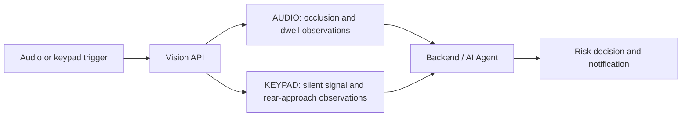

# OmniGuardy Vision

OmniGuardy combines Audio, Vision, and an AI Agent for entrance security. This repository implements the Vision analysis component.

## Overview

Vision receives an `AUDIO` or `KEYPAD` trigger with a camera window and returns observation events. The Backend and AI Agent own final risk assessment, alerting, and cross-modal decisions; this repository does not assign a final risk level.



`AUDIO` is an event-routing label, not audio inference inside this repository. The default path examines camera occlusion and person dwell; `KEYPAD` runs hand-gesture and person-tracking rules. Earlier behavior-classification models are preserved as an explicit fallback or experiment path, not the default exhibition route.

## Vision Pipeline

The MP4 API uses YOLOv8n person detection with BoT-SORT tracking and OpenCV. MediaPipe is used where pose or hand landmarks are required.

| Trigger | Default implemented path | Returned observation events |
| --- | --- | --- |
| `AUDIO` | OpenCV edge/Laplacian camera-occlusion rule + YOLOv8n/BoT-SORT person tracking + dwell rule, evaluated over the first 10 seconds | `CAMERA_OCCLUS_SUSPECTED`, `PERSON_DWELL_OBSERVED` |
| `KEYPAD` | MediaPipe HandLandmarker Silent Signal rule + YOLOv8n/BoT-SORT tracking + rear-approach rule | `SILENT_SIGNAL`, `REAR_CLOSE_APPROACH_SUSPECTED` |

The `KEYPAD` weapon-proximity event is code-gated by `VISION_ENABLE_WEAPON_DETECTION=true`; it is optional and not part of the default event set. `behavior` is `null` for the rule-based default paths. `VISION_AUDIO_MODE=temporal_trial6` explicitly enables the preserved temporal behavior-classification branch for `AUDIO`; it should not be interpreted as the final exhibition pipeline.

## Implementation & Optimization

### MP4 Vision API

`api/vision_api.py` exposes `POST /analyze/vision` on port 8000. It accepts an MP4 and trigger metadata, analyzes it, and returns observations. The detailed request/response and environment reference is in [MP4 Vision API](docs/mp4-api.md).

Optional optimization flags limit AUDIO tracking to its existing 10-second rule window and overlap independent OpenCV/MediaPipe work with the single tracking pass. They preserve the default sequential behavior when unset. Details are in the API reference and optimization report.

### JPEG Streaming API PoC

`experiments/streaming_poc/streaming_api_poc/app.py` is a separate FastAPI proof of concept on port 8010. It receives ordered JPEG frames for one session while MP4 recording can proceed independently in the surrounding system.

- `EARLY_EVENT` is a provisional callback emitted when the online Silent Signal rule confirms.
- `FINAL_RESULT` is the terminal session result retrieved by polling and records completeness separately from success.
- A `partial`, failed, timed-out, or incomplete stream is designed to select the existing MP4 path once for the same trigger; backend/Agent de-duplication is an integration responsibility.

The PoC includes ordered batch acceptance and retry handling. Its validation is localhost-only; Raspberry Pi delivery and production Backend/network integration remain unverified. See the [batch protocol](experiments/streaming_poc/streaming_api_poc/BATCH_API_SPEC.md) and [integration guide](experiments/streaming_poc/streaming_api_poc/INTEGRATION_GUIDE.md).

## Evaluation & Limitations

The following values are measurements under their own stated conditions, not a common end-to-end benchmark.

| Scope | Recorded result | Boundary |
| --- | --- | --- |
| MP4 API, representative HTTP requests | `AUDIO`: 39.235 s → 21.856 s; `KEYPAD`: 48.417 s → 28.711 s with relevant opt-in flags | Fresh local processes on Windows 11 / RTX 4060; one source clip per trigger. |
| Streaming API, KEYPAD local smoke | 210 JPEG frames over 6.994 s; final result at 8.357 s from capture start | Localhost only, one 30-FPS 960×540/Q85 replay; no Raspberry Pi, Spring Boot, production authentication, or network measurement. |
| Streaming event checks | `SILENT_SIGNAL@114`, rear approach at frame 43, and three tracked persons in the representative KEYPAD smoke | Representative scenario, not a corpus-wide accuracy result. |

The optimization measurements distinguish analysis-wall time from HTTP wall time; streaming reports distinguish local post-capture drain from transport or backend latency. They must not be added together or compared as a single “speedup.” See [MP4 optimization validation](experiment_results/vision_api_optimization/REPORT.md) and the [streaming Phase D report](experiment_results/streaming_poc/streaming_api_poc/phase_d/PHASE_D_REPORT.md).

Known limits include reviewed Silent Signal false positives, camera/rule sensitivity to resolution, incomplete broader event regression, and unverified Pi/Spring Boot/network deployment. Detailed cases and conditions are in [evaluation notes](docs/evaluation-and-limitations.md).

## Getting Started

Run commands from the repository root. The default paths require `tracking/yolov8n.pt`; `KEYPAD` also requires `hand_motion_desktop/src/models/hand_landmarker.task`. `models/pose_landmarker_lite.task` is required only by the preserved temporal-classifier route. Obtain these model assets through the project distribution before starting the service.

```powershell
python -m venv .venv
.\.venv\Scripts\Activate.ps1
python -m pip install -r requirements.txt
```

Start the default MP4 API:

```powershell
$env:VISION_AUDIO_MODE = "exhibition_rules"
$env:SILENT_SIGNAL_COORDINATE_MODE = "front"
$env:REAR_APPROACH_CAMERA_MODE = "front"
.\.venv\Scripts\python.exe -m uvicorn api.vision_api:app --host 0.0.0.0 --port 8000
```

Optionally start the independent streaming PoC in another terminal:

```powershell
.\.venv\Scripts\python.exe -m uvicorn experiments.streaming_poc.streaming_api_poc.app:app --host 0.0.0.0 --port 8010
```

`start-vision.ps1` additionally loads a locally stored callback key and configures an external callback host, so it is deployment-specific. Check `/health` after starting the MP4 API to confirm that the service is running and its configured `audioMode`.

## Earlier Experiments

The original block-level XGBoost pipeline and later GRU/temporal classifier work are preserved in [Earlier behavior-classification experiments](docs/earlier-experiments.md). Their label metrics describe those model experiments and must not be read as detection accuracy for the final rule-based `AUDIO`/`KEYPAD` system.

## Documentation

- [MP4 Vision API reference](docs/mp4-api.md)
- [Evaluation conditions and limitations](docs/evaluation-and-limitations.md)
- [Earlier behavior-classification experiments](docs/earlier-experiments.md)
- [Batch Frames API specification](experiments/streaming_poc/streaming_api_poc/BATCH_API_SPEC.md)
- [Pi / Spring Boot integration guide](experiments/streaming_poc/streaming_api_poc/INTEGRATION_GUIDE.md)
- [Streaming Phase D localhost validation](experiment_results/streaming_poc/streaming_api_poc/phase_d/PHASE_D_REPORT.md)
